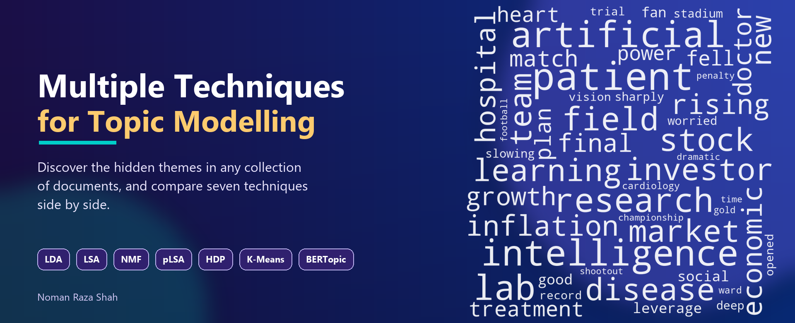
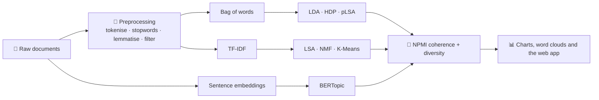
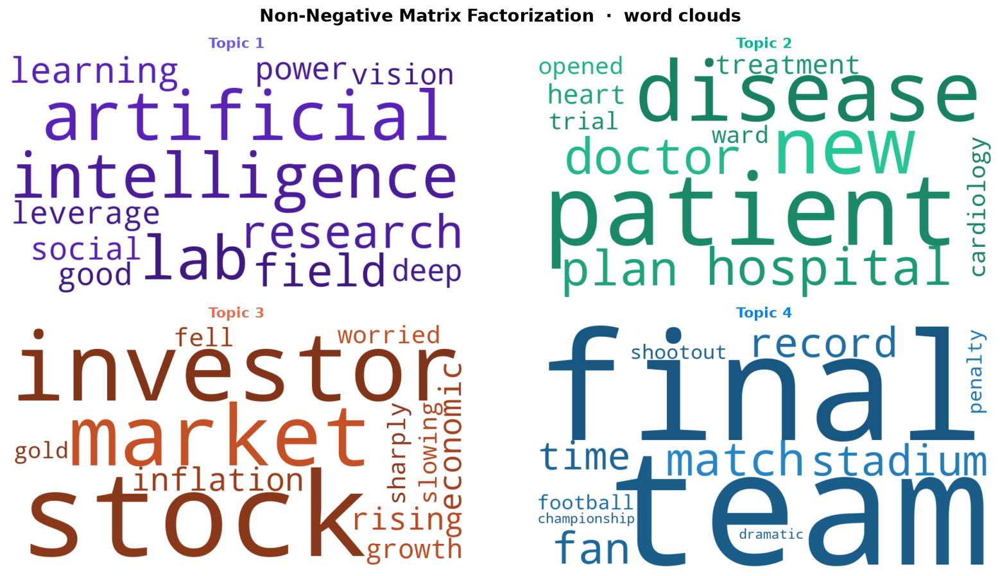
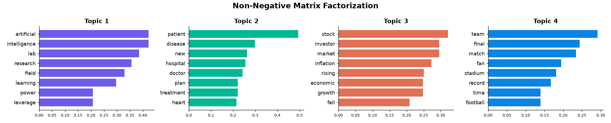

<p align="center">
  
</p>

<div align="center">

[](https://www.python.org/)
[](https://scikit-learn.org/)
[](https://radimrehurek.com/gensim/)
[](https://streamlit.io/)
[](https://www.nltk.org/)

[What is topic modelling?](#-what-is-topic-modelling) •
[Techniques](#-techniques) •
[Quick start](#-quick-start) •
[Web app](#-web-app) •
[Word clouds](#-word-clouds) •
[Results](#-results)

</div>

---

## 📖 What is Topic Modelling?

<p align="justify">
Topic modelling is the task of using <b>unsupervised learning</b> to extract the main topics, each represented as a set of words, that occur in a collection of documents. You don't need labels. Give it a pile of text and it tells you what the text is about.
</p>

Typical uses include organising news archives, analysing customer reviews and support tickets, mining research papers, tracking trends on social media, and generating tags or hashtags for content.

## ✨ Features

- 🧩 **7 techniques behind one interface**: probabilistic, matrix factorisation, clustering and neural models.
- ⚖️ **Fair comparison**: every model shares the same preprocessing (tokenising, stopword removal, lemmatisation, frequency filtering).
- 📏 **Built-in evaluation**: **NPMI coherence** and **topic diversity** for every model, with the best one highlighted.
- ☁️ **Word clouds**: one cloud per topic, with word size following the model's weight (`--plot`).
- 📊 **Charts**: per-topic word-weight plots plus a comparison chart (`--plot`).
- 🌐 **Streamlit web app**: paste text or upload a file and compare techniques in the browser.
- 🖥️ **Readable terminal output** powered by [Rich](https://github.com/Textualize/rich).
- 📂 **Bring your own data**: `.txt` (one document per line), `.csv`, or the built-in **20 Newsgroups** dataset.

## 🧪 Techniques

| # | Technique | Key | Family | How it works |
|:-:|-----------|:---:|--------|--------------|
| 1 | **Latent Dirichlet Allocation** | `lda` | Probabilistic | Documents are mixtures of topics; topics are probability distributions over words. |
| 2 | **Latent Semantic Analysis** | `lsa` | Matrix factorisation | Truncated SVD of the TF-IDF matrix uncovers latent "concepts". |
| 3 | **Non-Negative Matrix Factorization** | `nmf` | Matrix factorisation | Splits TF-IDF into non-negative, additive parts, which makes topics very interpretable. |
| 4 | **Probabilistic LSA** | `plsa` | Probabilistic | Probabilistic version of LSA, fit as KL-divergence NMF on word counts. |
| 5 | **Hierarchical Dirichlet Process** | `hdp` | Non-parametric Bayesian | An extension of LDA that **infers the number of topics** itself. |
| 6 | **K-Means Clustering** | `kmeans` | Clustering | Groups documents by TF-IDF similarity; each centroid's top terms form a topic. |
| 7 | **BERTopic** *(optional)* | `bertopic` | Neural embeddings | Transformer embeddings → UMAP → clustering → class-based TF-IDF. |



## 🚀 Quick Start

```bash
git clone https://github.com/<your-username>/Multiple-Techniques-for-Topic_Modelling.git
cd Multiple-Techniques-for-Topic_Modelling

python -m venv .venv
.venv\Scripts\activate          # Windows
# source .venv/bin/activate     # macOS / Linux

pip install -r requirements.txt
pip install bertopic            # optional, large download (PyTorch)

python Topic_Modelling_techniques.py --plot     # charts and word clouds
streamlit run app.py                        # open the web app
```

NLTK stopwords and WordNet are downloaded automatically on first run.

### Command-line usage

```bash
# List all techniques
python Topic_Modelling_techniques.py --list

# Run selected techniques with 5 topics and 10 words each, and save charts
python Topic_Modelling_techniques.py -t lda nmf hdp -k 5 -w 10 --plot

# Your own data: a .txt file (one document per line) or a .csv file
python Topic_Modelling_techniques.py -i reviews.txt
python Topic_Modelling_techniques.py -i tweets.csv --text-column text --stopwords rt amp

# A real benchmark dataset (downloaded automatically by scikit-learn)
python Topic_Modelling_techniques.py -d 20newsgroups --max-docs 2000 -k 8
```

| Option | Default | Description |
|--------|---------|-------------|
| `-i, --input` | | `.txt` or `.csv` file to analyse |
| `-d, --dataset` | `sample` | Built-in data: `sample` or `20newsgroups` |
| `-t, --techniques` | `all` | Any of `lda lsa nmf plsa hdp kmeans bertopic` (`all` = everything except BERTopic) |
| `-k, --num-topics` | `4` | Number of topics to extract |
| `-w, --num-words` | `8` | Top words shown per topic |
| `--stopwords` | | Extra domain-specific words to ignore |
| `--plot` | off | Save charts and word clouds to `--output-dir` (default `outputs/`) |
| `--seed` | `42` | Random seed for reproducible results |

## 🌐 Web app

The Streamlit app runs every technique in the browser. Paste your own text, upload a `.txt` or `.csv` file, or use the sample corpus, then compare word clouds, word weights and coherence scores.

```bash
streamlit run app.py
```

The app opens at `http://localhost:8501`. Pick the techniques and the number of topics in the sidebar, then press **Discover topics**.

## ☁️ Word clouds

Each topic gets its own cloud. A word is drawn larger when the model gives it a higher weight, so the theme of a topic is visible at a glance. `--plot` writes one image per technique, named `wordcloud_<technique>.png`.



## 📊 Results

These results come from the bundled [`data/sample_corpus.txt`](data/sample_corpus.txt): 40 short documents about **AI research, sports, health and finance**.

```text
┌────────────────── Non-Negative Matrix Factorization (NMF) ───────────────────┐
│   #   Top words                                                              │
│   1   artificial  intelligence  lab  research  field  learning  power        │
│   2   patient  disease  new  hospital  doctor  plan  treatment  heart        │
│   3   stock  investor  market  inflation  rising  economic  growth  fell     │
│   4   team  final  match  fan  stadium  record  time  football               │
└──────────────────────── Matrix factorisation · 0.02s ────────────────────────┘
```



| Technique | Coherence (NPMI) ↑ | Diversity ↑ | Time |
|-----------|:------------------:|:-----------:|:----:|
| **NMF** ★ | **0.291** | 1.000 | 0.02 s |
| LSA | 0.229 | 0.969 | 0.03 s |
| K-Means | 0.127 | 1.000 | 0.11 s |
| LDA | -0.074 | 0.906 | 0.41 s |
| pLSA | -0.117 | 1.000 | 0.02 s |
| HDP | -0.702 | 1.000 | 0.06 s |

> **Why does LDA score low here?** LDA and HDP estimate word distributions statistically, so they need many documents. With 40 one-sentence documents they mix themes together, while TF-IDF based methods (NMF, LSA) separate them cleanly. Run them on a larger corpus such as `-d 20newsgroups` and the probabilistic models become much more competitive.

### Understanding the metrics

- **Coherence (NPMI)** ranges from −1 to 1 and measures how often a topic's top words appear together in the corpus. Higher means more human-interpretable topics. NPMI is used instead of C_v because C_v can reward random word sets on small corpora.
- **Topic diversity** is the share of unique words across all topics' top words. A score of 1.0 means no two topics share a word.

## 🤔 Which technique should I use?

| Situation | Recommended |
|-----------|-------------|
| Short texts (tweets, titles, reviews), small corpora | **NMF**, **BERTopic** |
| Large corpora, need per-document topic probabilities | **LDA** |
| Unknown number of topics | **HDP**, **BERTopic** |
| Fast baseline, semantic search, dimensionality reduction | **LSA** |
| One clear topic per document | **K-Means** |
| Best semantic quality, a GPU is available | **BERTopic** |

## 🐍 Python API

```python
from topic_modelling import Corpus, load_documents, run_technique, coherence

corpus = Corpus(load_documents("data/sample_corpus.txt"))
result = run_technique("nmf", corpus, num_topics=4, num_words=8)

for i, words in enumerate(result.topic_words, 1):
    print(f"Topic {i}: {', '.join(words)}")

print("NPMI coherence:", coherence(result, corpus))
print(result.doc_topics.shape)   # (n_documents, n_topics)
```

## 📁 Project Structure

```text
Multiple-Techniques-for-Topic_Modelling/
├── app.py                          # Streamlit web app
├── Topic_Modelling_techniques.py   # CLI: run and compare techniques
├── topic_modelling/
│   ├── preprocessing.py            # Corpus: cleaning, dictionary, bag-of-words
│   ├── techniques.py               # LDA, LSA, NMF, pLSA, HDP, K-Means, BERTopic
│   ├── evaluation.py               # NPMI coherence & topic diversity
│   └── visualization.py            # Charts and word clouds
├── data/sample_corpus.txt          # 40-document demo corpus
├── assets/                         # Cover, charts and word clouds
└── requirements.txt
```

## 📚 References

1. Blei, Ng & Jordan (2003). [Latent Dirichlet Allocation](https://www.jmlr.org/papers/volume3/blei03a/blei03a.pdf). *JMLR*.
2. Deerwester et al. (1990). Indexing by Latent Semantic Analysis. *JASIS*.
3. Lee & Seung (1999). Learning the parts of objects by non-negative matrix factorization. *Nature*.
4. Hofmann (1999). Probabilistic Latent Semantic Analysis. *UAI*.
5. Teh et al. (2006). Hierarchical Dirichlet Processes. *JASA*.
6. Grootendorst (2022). [BERTopic: Neural topic modeling with a class-based TF-IDF procedure](https://arxiv.org/abs/2203.05794).
7. Bouma (2009). Normalized (Pointwise) Mutual Information in Collocation Extraction.

## 👤 Author

**Noman Raza Shah**

If you find this project useful, please give it a ⭐. Contributions and pull requests are welcome!
